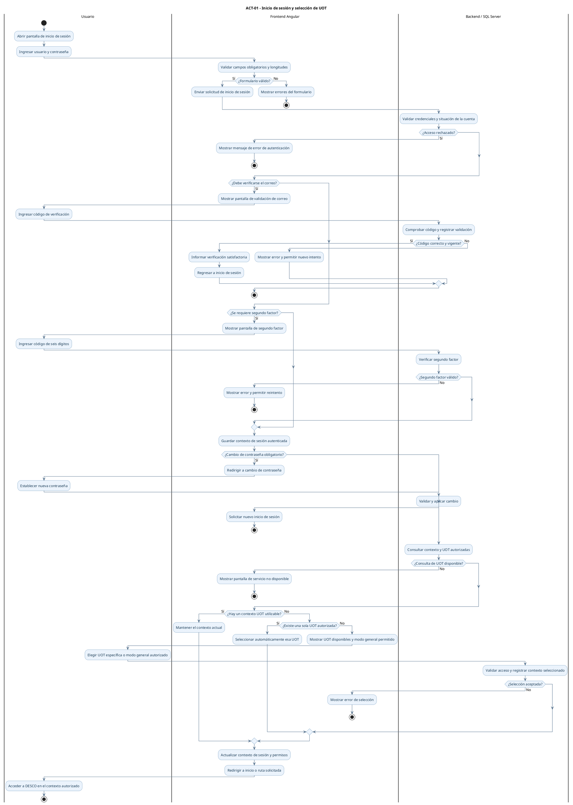
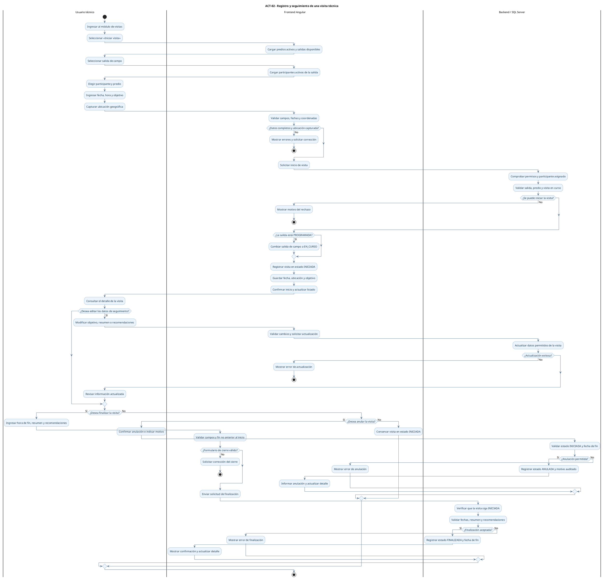
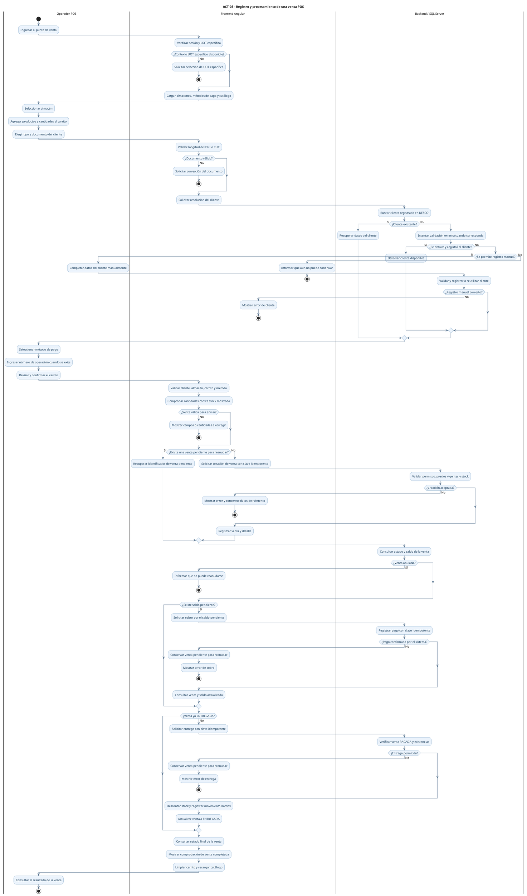
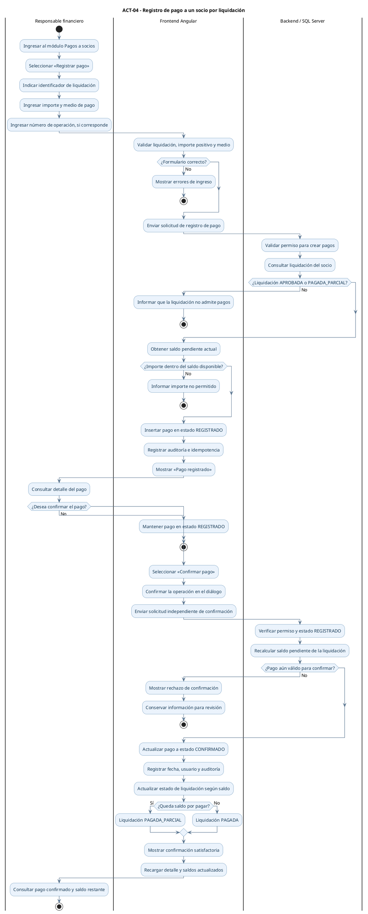

# DESCO — Diagramas UML de actividades (PlantUML)

**Proyecto:** DESCO – UOT Sara Sara  
**Documento:** Modelado de procesos principales para la tesis  
**Diagramas incluidos:** ACT-01, ACT-02, ACT-03 y ACT-04  
**Base:** código fuente vigente de Angular, Spring Boot y migraciones Flyway de SQL Server proporcionados el 19/10/2026.

## Compatibilidad con PlantUML

**Corrección de sintaxis:** en los cuatro diagramas, el primer carril se declara **antes** de `start` (por ejemplo, `|Usuario|` seguido por `start`). PlantUML lo exige cuando se utilizan *swimlanes* con la sintaxis moderna de actividades. Los restantes carriles se declaran a medida que avanza el flujo.

## Criterios de modelado

- Los diagramas son **de actividades UML**, no diagramas de secuencia. Utilizan particiones (*swimlanes*) para separar las acciones del usuario, del frontend y del backend/base de datos.
- Muestran los **flujos funcionales relevantes** y los resultados alternativos, no todos los métodos internos, consultas SQL ni excepciones técnicas.
- Los nombres de estados y operaciones funcionales siguen el código revisado. Las acciones de base de datos describen el resultado del procedimiento almacenado, no pretenden reproducir su implementación línea por línea.
- Cada bloque `plantuml` es autónomo: puede copiarse completo en PlantUML para generar una figura independiente.

---

## ACT-01 — Inicio de sesión y selección de UOT

**Objetivo:** representar la autenticación, las verificaciones adicionales y la resolución del contexto de unidad de organización territorial (UOT).  
**Inicio:** un usuario abre la pantalla de acceso.  
**Fin esperado:** el usuario autenticado accede a DESCO con el contexto UOT resuelto.  
**Variantes:** credenciales inválidas; validación de correo; segundo factor; cambio obligatorio de contraseña; selección manual o automática de UOT.

**Correspondencia con el código:** `login.ts`, `segundo-factor.ts`, `validacion-correo.ts`, `cambio-password-obligatorio.ts`, `uot-context.guard.ts`, `uot-selection.ts`, `UotApiService`, `AuthController`, `UotController`. La pantalla de validación de correo devuelve al usuario a `/login`; la selección automática de UOT se realiza cuando hay una sola UOT autorizada sin seleccionar.

---

## ACT-02 — Registro y seguimiento de una visita técnica

**Objetivo:** representar el inicio, seguimiento y cierre de una visita técnica vinculada a una salida de campo.  
**Inicio:** el personal habilitado accede a la sección de visitas.  
**Fin esperado:** la visita queda en estado `FINALIZADA`; también puede conservarse `INICIADA` o terminar `ANULADA` según la acción elegida.  
**Reglas relevantes:** salida `PROGRAMADA` o `EN_CURSO`, participante válido, predio activo, datos de inicio completos, resumen y recomendaciones al finalizar.

**Correspondencia con el código:** `visitas-list.ts`, `visita-detail.ts`, casos de uso `iniciar-visita`, `editar-visita`, `finalizar-visita`, `anular-visita`, `VisitApplicationService`; migraciones `V28__CP_campo.PA_VisitaTecnica_Ins_Iniciar.sql`, `V31__CP_campo.PA_VisitaTecnica_Upd_Anular.sql` y `V32__CP_campo.PA_VisitaTecnica_Upd_Finalizar.sql`. En la implementación, una visita se inicia a través del **participante de una salida**, no mediante una visita aislada.

---

## ACT-03 — Registro y procesamiento de una venta POS

**Objetivo:** representar la venta en punto de venta, desde la selección del almacén hasta el cobro y entrega.  
**Inicio:** un usuario autorizado ingresa al POS desde una UOT específica.  
**Fin esperado:** venta en estado `ENTREGADA` y carrito liberado.  
**Variantes:** cliente existente, cliente importado o registro manual permitido; validaciones de stock, método de pago y errores recuperables al cobrar o entregar.

**Correspondencia con el código:** `pos-page.ts`, `pos-cart.store.ts`, `procesar-venta-pos.use-case.ts`, `pos-http.adapter.ts`, `SaleController`, `SaleApplicationService`, migraciones `V395__AP_comercial.PA_Venta_Ins_Registrar.sql` y `V406__AP_comercial.PA_Venta_Upd_Entregar.sql`. El caso de uso POS **crea o recupera la venta, registra el pago de su saldo y finalmente solicita la entrega**. La entrega se realiza únicamente cuando se cumplen las condiciones de pago y existencias.

---

## ACT-04 — Registro de pago a un socio por liquidación

**Objetivo:** representar el registro y la confirmación del pago asociado a una liquidación de socio existente.  
**Inicio:** el responsable autorizado accede a pagos a socios y solicita registrar uno nuevo.  
**Fin esperado:** pago `CONFIRMADO`, con saldo de la liquidación actualizado según los pagos confirmados; también puede quedar `REGISTRADO` mientras espera confirmación.  
**Reglas relevantes:** liquidación `APROBADA` o `PAGADA_PARCIAL`, importe positivo no superior al saldo y confirmación en una acción independiente.

**Correspondencia con el código:** `pago-socio-form.ts`, `pago-socio-detail.ts`, `pagos-socios-http.adapter.ts`, `liquidaciones-list.ts`, `liquidacion-detail.ts`, `PaymentController`, `PaymentApplicationService`; migraciones `V125__CP_finanzas.PA_LiquidacionSocio_Upd_Aprobar.sql`, `V126__CP_finanzas.PA_Liquidacion_Sel_SaldoPendienteInterno.sql`, `V127__CP_finanzas.PA_PagoSocio_Ins_Registro.sql` y `V131__CP_finanzas.PA_PagoSocio_Upd_Confirmar.sql`. En DESCO **registrar** y **confirmar** el pago son dos acciones independientes; los pagos `REGISTRADO` no se suman como pagados hasta su confirmación.

---

## Uso del documento

1. Copia el contenido de un bloque `plantuml`, incluyendo `@startuml` y `@enduml`.
2. Pégalo en un editor compatible con PlantUML y genera la imagen PNG o SVG.
3. Incorpora las figuras en el apartado de *diagramas de actividades* de la tesis, conservando los códigos ACT-01 a ACT-04.

**Observación metodológica:** los diagramas representan los **procesos implementados en DESCO** a un nivel apropiado para una tesis. Los mensajes de error y la presentación exacta pueden variar en ejecución; los controles de acceso y reglas de negocio se mantienen en el backend y SQL Server. En ACT-01 la validación de correo y el cambio obligatorio de contraseña concluyen llevando a un nuevo inicio de sesión, conforme a la navegación implementada.
